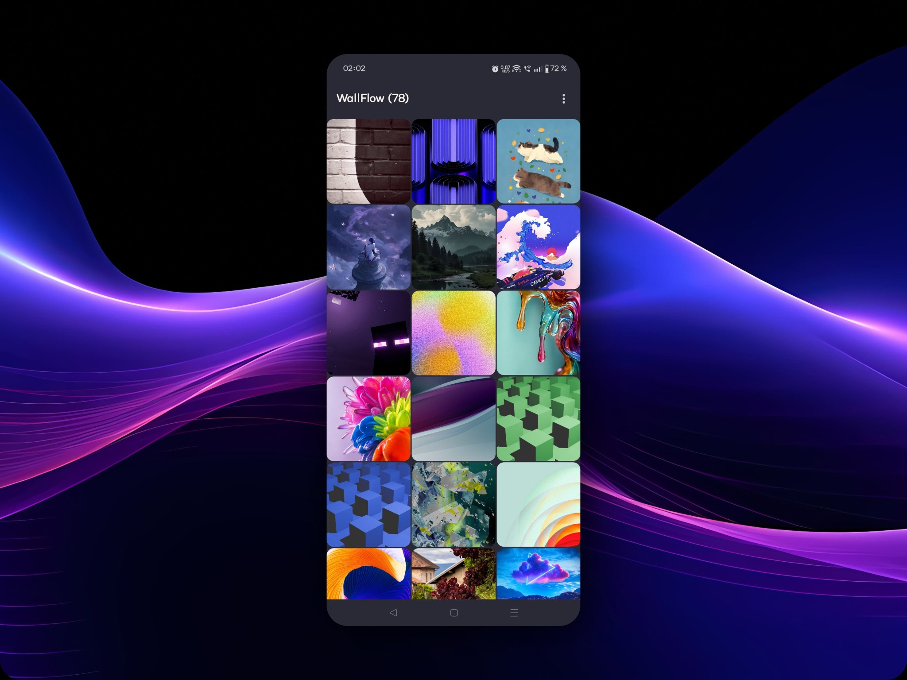
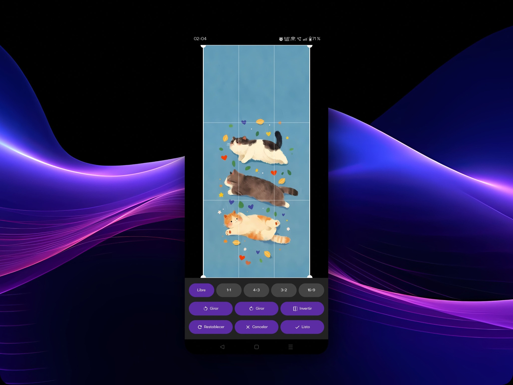
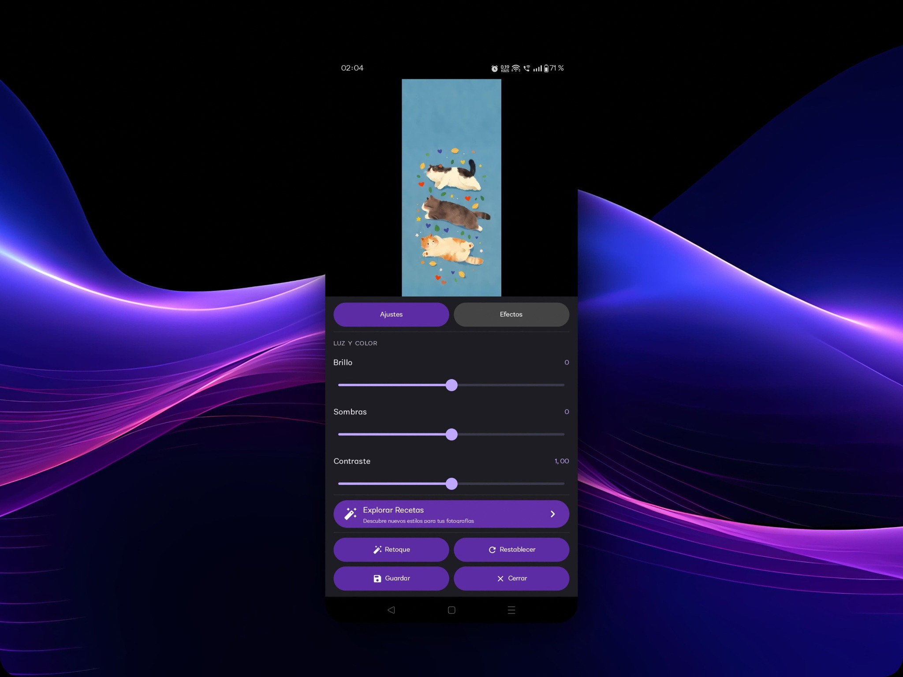
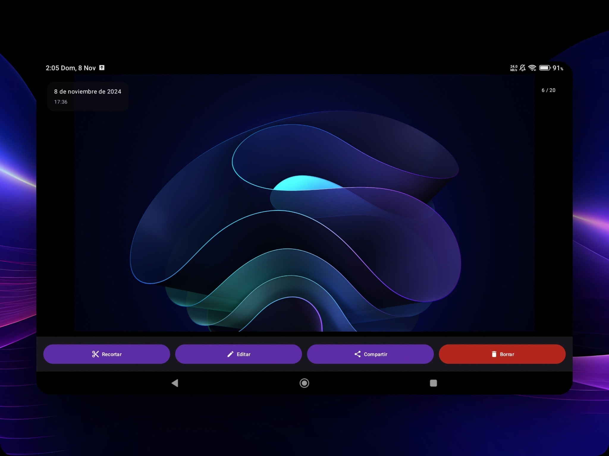
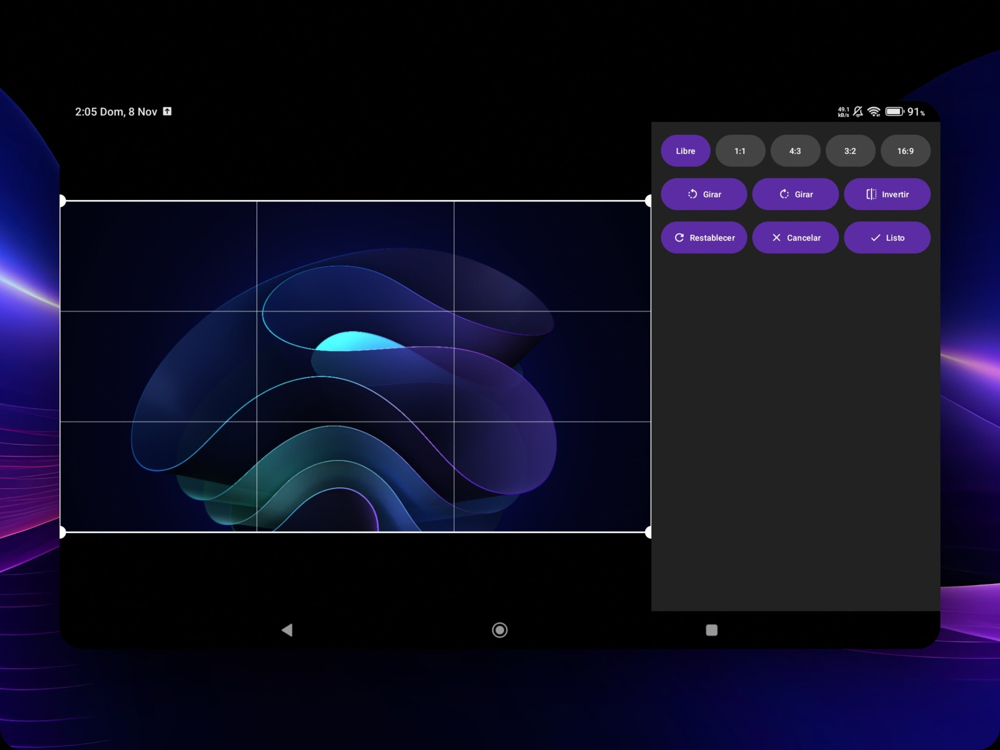
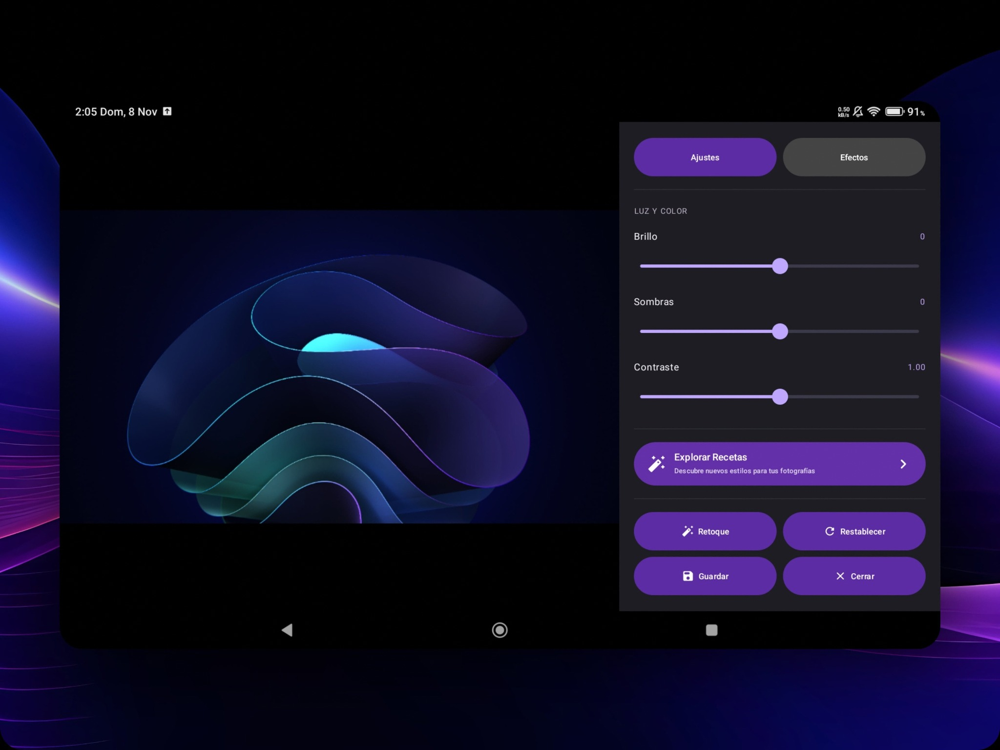

<div align="center">

# Nuvora

### Your photography, your style.

**An Android photo gallery with viewing and editing tools, designed to adapt to phones and tablets.**


</div>

---

## ✨ About Nuvora

Nuvora is an Android photo gallery app. It brings together image browsing, full-screen viewing, and photo editing tools in a dark interface with violet accents.

The project is designed to provide an adaptive experience: the interface rearranges its elements to make the most of both a phone's display and a tablet's larger screen.

## 📱 App Preview

> The images below are **presentation mockups** based on screenshots of the app. They showcase how Nuvora looks across different screen sizes.

### Phone

<p align="center">
  
  
  
</p>

### Tablet

<p align="center">
  
</p>
<p align="center">
  
  
</p>

## 🧩 Features

- **Photo library:** browse images organized into folders.
- **Flexible views:** switch between grid and list layouts.
- **Photo viewer:** paged image viewing, including date and position within the collection.
- **Multi-selection:** select multiple images to share or delete them.
- **Cropping:** freeform cropping and predefined aspect ratios.
- **Transformations:** rotate and flip images horizontally.
- **Image adjustments:** brightness, shadows, contrast, and saturation.
- **Effects:** sepia, black and white, and vignette.
- **Automatic enhancement:** automatically adjust an image.
- **Adaptive layout:** dedicated layouts for phones and tablets.
- **Non-destructive saving:** edited images are exported as copies to `Pictures/Nuvora`, leaving the original photo untouched.

## 🛠️ Tech Stack

| Technology | Purpose |
|---|---|
| Kotlin | Main programming language |
| Jetpack Compose | Declarative UI |
| Material 3 | UI components and visual system |
| Coil | Image loading |
| DataStore Preferences | App preferences |
| AndroidX | Android components and compatibility |
| Gradle | Project build system |

## 📋 Requirements

- Android 8.0 (API 26) or later.
- JDK 17 to build the project.
- Android SDK with Android 14 / API 34 to build this project version.

## 🚀 Build from Source

1. Clone the repository:

   ```bash
   git clone <REPOSITORY_URL>
   cd Nuvora
   ```

2. Open the project in Android Studio and wait for Gradle synchronization to finish.

3. Run the app from Android Studio or build a debug APK:

   ```bash
   gradle assembleDebug
   ```

The APK will be generated at:

```text
app/build/outputs/apk/debug/app-debug.apk
```

## ⚙️ Continuous Integration

The repository includes a GitHub Actions workflow (`.github/workflows/build.yml`) that can be triggered manually to build a debug APK and publish it as a workflow artifact.

## 🗺️ Project Status

Nuvora is under active development. The features listed above reflect the implementation in this version of the source code; the interface and capabilities may evolve.

## 📄 License

Unless otherwise stated, Nuvora's original source code is licensed under the **GNU General Public License v3.0 only (GPL-3.0-only)**. See [LICENSE](LICENSE) for the complete license text.

Copyright (C) 2026 oracevedo86.

Third-party dependencies and components remain subject to their respective licenses and terms.

## 🤝 Credits

Nuvora is an independent project. Its design, direction, and implementation continue to evolve through iterative development, device testing, and AI-assisted collaboration.

---

<div align="center">

**Nuvora — Your photography, your style.**

</div>
